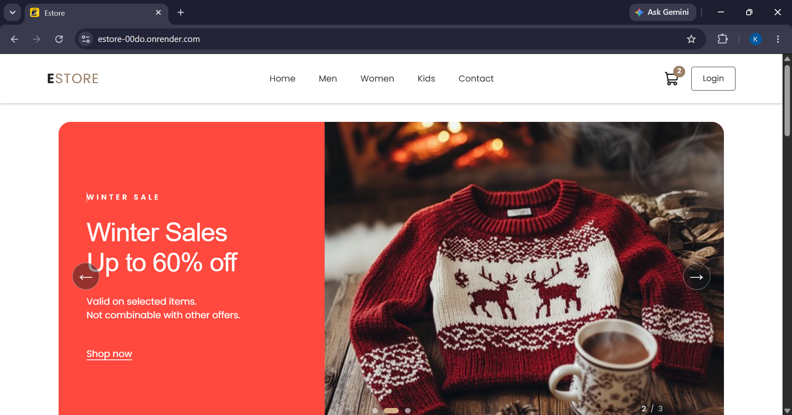

# 🛍️ E STORE

A modern and responsive Fashion & Lifestyle E-commerce Website built using React.js and Vite. The website provides a smooth shopping experience with product categories, search, filtering, and cart functionality.

---

## 🚀 Features

- Responsive design
- Men, Women & Kids collections
- Hero image slider
- Shopping cart with LocalStorage
- Login and Signup
- React Router navigation
- Context API for state management

---

## 🛠️ Technologies Used

- React.js
- Vite
- JavaScript
- HTML5
- CSS3
- React Router DOM
- Context API
- Lucide React

---

## 📸 Screenshot

---

## 🔗 Live Demo

https://estore-00do.onrender.com/

---

## 📌 How to Run

1. Clone the repository
2. Navigate to the project folder
3. Run `npm install`
4. Run `npm run dev`

---

## 🎯 Project Purpose

This project was built to practice React concepts like components, props, hooks, Context API, React Router, and LocalStorage while developing a modern e-commerce user interface.

---

## 👨‍💻 Author

**Kaushal Jangir**